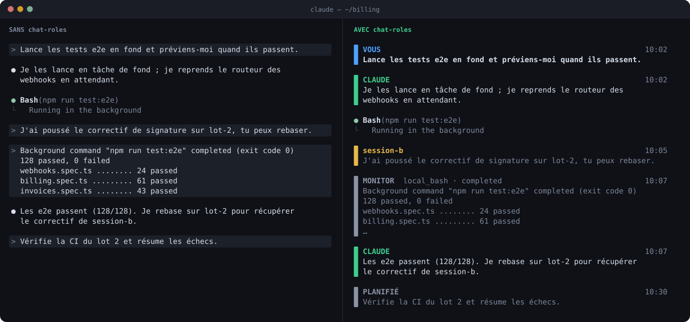

# Chat roles pour Claude Code

Un mod pour [Claude Code](https://claude.com/claude-code) qui marque chaque message du flux d'une barre de couleur, d'une étiquette et de l'heure, pour voir d'un coup d'œil qui parle :

<p align="center">
  
</p>

<sub>Maquette animée, dessinée d'après le rendu du mod. Dans le terminal, la barre est une colonne de cellules et les couleurs sont celles du mod.</sub>

## Ce que ça change

Sans le mod, tout ce qui arrive dans le tour « utilisateur » s'affiche comme un prompt `>` : vos messages, ceux d'une autre session, la fin d'une tâche de fond, un déclencheur planifié. Avec le mod, chacun est nommé, coloré et daté :

<p align="center">
  
</p>

| Étiquette | Couleur | Qui |
| --- | --- | --- |
| `VOUS` | bleu | vos prompts (terminal, bridge, SDK) |
| `CLAUDE` | vert | les réponses de Claude |
| nom de l'expéditeur, ou `AUTRE SESSION` | ambre | les messages d'autres sessions, de canaux ou d'un coordinateur |
| `@auteur  Cantina table` | ambre | un message d'un autre agent, remis par la Cantina de [KoA](https://github.com/Happykiller/koa-releases) |
| `@po, @qa → @dev  Cantina table · n messages` | gris | un avis de la Cantina (table en mode avis) : le courrier est à lire avec `cantina_courrier` |
| `MONITOR`, `PLANIFIÉ` | gris | notifications de tâches de fond et déclencheurs planifiés |

KoA remet les messages de la Cantina en les collant dans la saisie, si bien que Claude Code les enregistre comme vos prompts ; le mod les reconnaît à leur première ligne et les rend à leur auteur. Replié, le message perd son en-tête et la formule de fin destinée à l'agent ; déplié, il s'affiche en entier.

Les messages qui ne viennent pas de vous sont repliés sur quatre lignes tant qu'ils ne sont pas dépliés. L'heure d'arrivée de chaque message est retenue d'une session à l'autre.

## Installation

Dans une session Claude Code, au terminal :

```
/plugin install chat-roles --marketplace Happykiller/claude-chat-roles
```

Répondez `y` à `Add marketplace?`, puis choisissez une portée (la portée user, proposée en premier, l'active dans toutes vos sessions).

Depuis un shell :

```
claude plugin install chat-roles --marketplace Happykiller/claude-chat-roles
```

Dans l'application desktop, où `/plugin` ne s'exécute pas : cliquez sur + à côté de la zone de prompt, puis Plugins, Add marketplace avec `Happykiller/claude-chat-roles`, puis Add plugin.

## Développement

```
claude plugin validate .
claude plugin test .
claude --plugin-dir .
```

Les maquettes du README se régénèrent avec `python3 docs/make_demo.py`.
